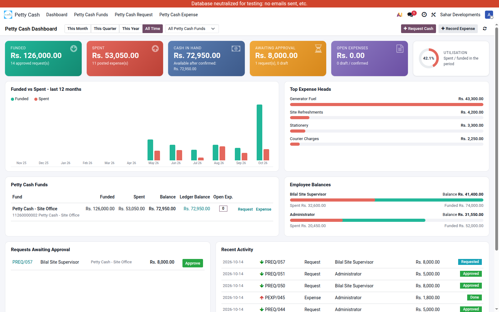

# Petty Cash Management (`dev_petty_cash`)

Small, day-to-day cash spending at a site or office: an employee asks for a float,
a manager approves it (the money moves from the bank into a petty cash fund), the
employee records what was spent, and a manager posts it to the expense accounts.
A dashboard shows funds, spending and balances at a glance.

Depends on: `account`, `hr`. Odoo 19.

---

## 1. One-time setup

| Step | Where | What |
|---|---|---|
| 1 | Accounting > Configuration > Journals | Create a **Cash** journal per fund (e.g. *Petty Cash - Site Office*) and tick **Is Petty Cash**. Its default account is the petty cash account (asset). |
| 2 | same | The bank/cash journal the money comes **from** (e.g. *UBL AMEEN*) stays a normal journal - do **not** tick Is Petty Cash on it. It needs an outgoing payment method (Manual). |
| 3 | Settings > Users | Give people the **Petty Cash** access: **User: Own Documents Only** (sees and creates own requests/expenses) or **Manager: All Documents** (sees everything, approves requests, posts expenses). |
| 4 | Employees | Every person who requests or spends cash needs an **Employee** (linked to their user, so it is filled in automatically). |
| 5 | Products (optional) | Create service products for the usual expense heads (Fuel, Refreshments, Courier, Stationery...) with an **Expense Account** and a cost - picking one on an expense line fills the account and amount. |

---

## 2. The flow

```
 Petty Cash Request                         Petty Cash Expense
 ──────────────────                         ──────────────────
 Draft ──Request Cash──> Requested          Draft ──Confirm──> Confirm ──Post Expense──> Done
                           │  │                                   (balance check)   (manager; journal entry)
            Approve Request│  │Reject / Cancel
               (manager)   v  v                          Cancel (any time after Confirm)
                     Approved  Reject / Cancel           -> the journal entry is cancelled too
        (payment posted: bank -> petty cash)            Set To Draft (from Confirm / Cancel)
```

### 2.1 Request (fund the petty cash)

*Petty Cash > Petty Cash Request > New* (or **Request Cash** on the dashboard).

| Field | Meaning |
|---|---|
| Request By | the employee who will hold / spend the cash (defaults to you) |
| Request To | the person asked to approve |
| From (Payment Journal) | bank / cash journal the money leaves (a normal journal) |
| To (Petty Cash Journal) | the petty cash fund receiving it (Is Petty Cash) |
| Request Amount | must be more than 0 |

1. **Request Cash** -> state *Requested* (amount must be positive).
2. A manager clicks **Approve Request** -> a payment is created and posted:

   | Account | Debit | Credit |
   |---|---|---|
   | Petty cash journal's account (e.g. 11260000002 Petty Cash - Site Office) | 10,000 | |
   | Bank journal's account (or its *Outstanding Payments* account, if the bank journal uses one) | | 10,000 |

   The payment is shown on the request (**Payment**). State becomes *Approved*.
3. **Reject** / **Cancel** stop the request (nothing is posted); **Set To Draft** reopens it.

Only a **Manager** can approve or reject (the buttons are hidden for users and the server refuses it too).

### 2.2 Expense (spend from the petty cash)

*Petty Cash > Petty Cash Expense > New* (or **Record Expense** on the dashboard).

| Field | Meaning |
|---|---|
| Employee | who spent the money (defaults to you) |
| From (Petty Cash Journal) | the fund the money was taken from |
| Expense Lines | Particulars (product), Description, Account (expense account), Analytic Account, Amount |
| Balance | what this employee still has in this fund = approved requests - confirmed/done expenses (other than this one) |
| Remaining Amount | Balance - this expense |

1. **Confirm** - checks there is at least one line, the total is positive and the total is
   **not more than the Balance** (spending the exact balance is allowed). A confirmed expense
   already reserves its amount, so two expenses can't spend the same money.
2. A manager clicks **Post Expense** -> a journal entry is posted in the petty cash journal:

   | Account | Debit | Credit |
   |---|---|---|
   | each line's expense account (with its analytic account at 100 %) | 1,800 | |
   | petty cash journal's account | | 1,800 |

   State becomes *Done*; the **Journal Entry** button opens the entry.
3. **Cancel** (after Confirm or Done) cancels the expense and its journal entry (the money is
   back in the fund); **Set To Draft** reopens it for editing.

### 2.3 Balances - where the numbers come from

* **Employee balance in a fund** = approved requests (Request By = employee) - expenses in
  *Confirm* / *Done* for the same employee and fund. Used by the Confirm check.
* **Fund balance** (dashboard) = approved requests - posted expenses of that fund.
* **Ledger balance** (dashboard, accounting users only) = the posted balance of the fund's
  account in the general ledger. It should equal the fund balance; a difference means
  something was posted to that account outside this app.

---

## 3. Dashboard

*Petty Cash > Dashboard* (opens first when you click the app).



| Part | Shows | Click |
|---|---|---|
| Toolbar | Period (This Month / Quarter / Year / All Time) and fund filter; **Request Cash** / **Record Expense** | |
| Funded | approved requests in the period | list of those requests |
| Spent | posted expenses in the period | list of those expenses |
| Cash in Hand | all-time funded - spent (+ what is left after confirmed expenses) | |
| Awaiting Approval | requests in *Requested* (+ drafts count) | list |
| Open Expenses | expenses in Draft / Confirm | list |
| Utilisation | spent / funded in the period | |
| Funded vs Spent | bar chart, last 12 months | hover for amounts |
| Top Expense Heads | posted spending by product in the period | |
| Petty Cash Funds | per fund: funded, spent, balance, ledger balance, open expenses, quick Request / Expense | ledger balance opens the journal items |
| Employee Balances | funded (green) vs spent (red) per employee, with balance | |
| Requests Awaiting Approval | oldest first; managers get an **Approve** button right there | request number opens it |
| Recent Activity | last 10 requests / expenses | opens the document |

A *User: Own Documents* sees only their own figures; a Manager sees everybody's.
Amounts are shown in the company currency.

Other screens:
* *Petty Cash Funds* kanban - menu hidden (commented out in `views/petty_cash_kanban_views.xml`); per-fund figures are on the Dashboard.
* **Petty Cash Request / Expense** lists - filters (status, date), group by employee / fund /
  status / month, totals, and **Pivot** / **Graph** views for analysis.
* **Print** (on a request / expense) - PDF *Petty Cash Request* / *Petty Cash Expense*.

### 3.1 Petty Cash Report (PDF / Excel)

*Petty Cash > Reporting > Petty Cash Report*, or **Reports** on the dashboard (takes the selected fund).

| Option | Meaning |
|---|---|
| From / To | the period; everything before *From* becomes the opening balance |
| Petty Cash Funds / Employees | filters (empty = all) |
| Include Confirmed Expenses | also count confirmed, not yet posted expenses as spent (default: posted only, like the dashboard) |
| Report | **Full** (all three below), **Summary**, **Cash Book** or **Expense Detail** |
| Group Expense Detail By | Expense Head / Employee / Account / Fund |

* **Summary** - Opening / Funded / Spent / Closing cards; per fund and per employee
  (opening, funded, spent, closing); spending by expense head and by account with % of spent.
* **Cash Book** - one statement per fund: opening balance, every funding (received) and
  expense (paid) in date order with a running balance, closing balance.
* **Expense Detail** - every expense line (date, expense, employee, fund, head, description,
  account, analytic, amount) grouped with subtotals.

**Print PDF** - A4 landscape with its own letterhead on every page (logo, company, address,
report title, period, filters) and footer (printed by / at, company phone-email-website,
page X of Y), plus Prepared / Checked / Approved By signature lines.
**Export Excel** - one sheet per part (Summary, Cash Book, Expense Detail) with the same
letterhead (logo), number formats, frozen headings, auto-filter on the detail, and a print
header/footer.

Both read with the user's rights: a *User: Own Documents* gets only their own figures.
Employee filter uses the public employee profile, so users without HR rights can use it.

---

## 4. Security

| Group | Can |
|---|---|
| User: Own Documents Only | create and see own requests / expenses, request cash, confirm own expenses, see own dashboard figures |
| Manager: All Documents | everything above for all users + approve / reject requests, post expenses, see all figures |

Multi-company: documents follow the active companies; journals are limited to the document's company.

---

## 5. Testing (copy DB only - never staging)

```bash
cd sahar_development
# copy DB server
bin/python ../src/odoo/odoo-bin -c config/sahar.conf -d sahar_e2e_test --db-filter='^sahar_e2e_test$' \
    --http-port=8111 --gevent-port=8112
# in another terminal: shell checks (rolled back) + demo data + headed Playwright run
addons/staging_sahar/sahardevlopment/dev_petty_cash/e2e/run_e2e.sh
```

* `e2e/shell_flow_test.py` - 40 checks: request/approve postings, expense entry and analytic,
  balance rules (exact balance allowed, over balance refused, confirmed expenses reserve),
  cancel reverses the ledger, dashboard figures, journal counters, user rights.
* `e2e/browser_fixture.py` - creates *Petty Cash - Site Office*, two employees and five
  months of history in `sahar_e2e_test` (refuses to run on another DB).
* `e2e/petty_cash_flow.spec.js` - in the browser: dashboard -> request -> approve -> expense ->
  confirm -> post -> journal entry -> dashboard updated -> approve from dashboard -> filters ->
  fund kanban -> pivot. Screenshots in `e2e/screenshots/`.

---

## 6. Changes (vs. the original DevIntelle module)

19.0.1.6: Petty Cash Report wizard (PDF + Excel), Reports button on the dashboard,
*Petty Cash Funds* menu hidden.

19.0.1.4:

* **Accounting fixed.** Approving a request used to post *Dr Bank / Cr Petty Cash* (backwards)
  and an expense posted *Dr Bank / Cr Petty Cash* again, never touching the expense accounts;
  "Reconcile Payment" reconciled nothing. Now: request = *Dr Petty Cash / Cr Bank*, expense =
  *Dr expense accounts (+ analytic) / Cr Petty Cash*. The Register Payment / Reconcile steps
  are replaced by **Post Expense** (the old *Process Payment* state is kept only for old data).
* An expense equal to the full balance is accepted; confirmed expenses reserve the balance;
  expenses without lines are refused.
* Approve / Reject / Post Expense are manager-only.
* Employee contacts of another company no longer break the payment (company check).
* Users of the app can read journals (they couldn't open their own forms before).
* The "Pending" counter on the fund card used a wrong filter; fixed.
* The expense PDF was bound to the wrong model; fixed.
* New: dashboard, search filters / group-bys, pivot and graph views, list totals and badges.

Not used by the flow: *To (Payment Journal)* on the expense (hidden) and the old
`create_vendor_bill` helper.
